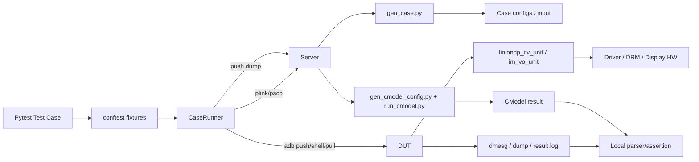
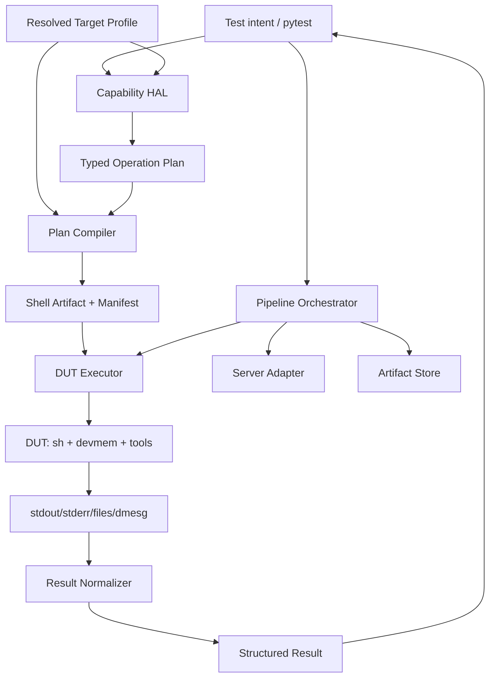

# auto_test 平台抽象化设计

## 1. 文档目的

本文以当前 `auto_test` 为切口，结合 `display` 目录下的 `tools`、`sv_case`、`template`、`display_it` 与 `display_cmodel`，定义一套可增量落地的平台抽象方案。

设计目标不是只把寄存器地址搬进 YAML，而是将以下变化隔离在稳定边界之后：

- SoC 寄存器地址、字段、复位值与访问语义；
- 板级上电、复位、QChannel 与时钟控制差异；
- DUT 上的驱动名、模块参数、debugfs/sysfs 节点和测试程序；
- Local PC、Server、DUT 之间的执行与传输工具差异；
- 不同实验室连接、路径与凭据配置；
- `linlondp_cv_unit`、`im_vo_unit` 等执行后端的能力差异。

核心边界保持不变：

> Local PC 负责平台解析、操作编排和 Shell 生成；DUT 只需要 Shell、`devmem`、驱动和测试程序，不要求安装 Python。

本文是架构与接口设计，不在本阶段一次性改写历史用例。

## 2. 分析范围与事实基线

### 2.1 目录角色

| 目录 | 角色 | 当前主要内容 |
| --- | --- | --- |
| `auto_test/` | Pytest 调度与验证层 | fixture、CaseRunner、ADB/Server 封装、日志解析、寄存器 Shell 用例 |
| `tools/` | Case 生成与参考模型工具链 | YAML→XML、图像/MDP 转换、Case 生成、CModel 配置与运行 |
| `sv_case/` | 测试意图和生成产物 | `top_config.yaml`、DUT 配置、dump、trace、CModel 结果 |
| `template/` | Case 生成模板 | 输入图像、raw/MDP、结果检查脚本 |
| `display_it/` | DUT 侧 VO/DRM 测试程序 | `im_vo_unit`、CRC/极性采集、DRM atomic/page-flip |
| `display_cmodel/` | 参考模型后端 | `linlon_dpu` 可执行文件及说明 |

`display` 下约 1853 个文件中，大部分是 `sv_case` 的重复生成物。框架设计应以源码、配置模式和产物契约为分析对象，而不是逐个复制生成文件的结构。

### 2.2 当前测试拓扑



### 2.3 当前控制流

`CaseRunner.run_pipeline(case_name)` 的实际控制流为：

1. Server 上进入 `sv_case/<case_name>`；
2. 执行 `gen_case.py` 生成 XML、输入和检查脚本；
3. Server → Local 拉取 DUT 所需文件；
4. Local → DUT 推送到 `/tmp/dpu_test/<case_name>`；
5. DUT 执行 `linlondp_cv_unit` 或 `im_vo_unit`；
6. DUT 生成 `result.log`、dump 和 dmesg；
7. Local 拉回 dump，再推送到 Server；
8. Server 运行 CModel；
9. Local 解析 PPI、CRC、极性、异常和 CModel 日志；
10. Pytest 做最终断言并生成 HTML 报告。

### 2.4 当前数据流

```text
top_config.yaml
    -> gen_case.py
    -> linlondp_cv_unit_config.xml + input mdp/raw + check_result.sh
    -> DUT execution
    -> register dump + write-back dump + dmesg
    -> gen_cmodel_config.py
    -> linlon_dpu
    -> CRC / pixel / register comparison
    -> pytest assertion/report
```

`sv_case/*/top_config.yaml` 已经是较好的“测试意图层”，可表达 display、layer、format、crop、blend、transform、gamut、gamma 等语义。平台抽象不应破坏这套数据模型，也不应把 SoC 物理地址写回该层。

## 3. Verification-Relevant Architecture Summary（验证相关架构摘要）

### 3.1 Block hierarchy

```text
Test Suite
├── Pytest orchestration
│   ├── environment fixtures
│   ├── driver fixtures
│   ├── pipeline fixtures
│   └── result assertions
├── Platform control
│   ├── register access
│   ├── reset/power/QChannel
│   ├── driver/module control
│   └── debugfs/sysfs control
├── Case generation
│   ├── top_config.yaml
│   ├── XML generation
│   └── image/MDP generation
├── DUT execution
│   ├── linlondp_cv_unit
│   ├── im_vo_unit
│   ├── DRM/display driver
│   └── shell scripts
└── Result checking
    ├── DUT result.log
    ├── dmesg monitor
    ├── register/CRC/polarity
    └── CModel comparison
```

### 3.2 External interfaces

| 接口 | 当前协议 | 关键契约 |
| --- | --- | --- |
| Local ↔ Server | `plink` / `pscp` | 远端路径、环境初始化、退出码、产物路径 |
| Local ↔ DUT | `adb push/pull/shell` | 设备选择、远端目录、命令退出码、stdout/stderr |
| Pytest ↔ CaseRunner | Python 方法 | `run_pipeline()` 返回字符串状态 |
| CaseRunner ↔ generator | Shell CLI | `gen_case.py`、`gen_cmodel_config.py` 参数 |
| DUT script ↔ HW | `devmem` / `atool devmem` | 地址、宽度、值、访问副作用 |
| Test ↔ driver | module/debugfs/sysfs | 驱动名、加载顺序、节点路径、写入协议 |
| DUT ↔ Local parser | `dmesg` / result files | 日志格式、PASS 标识、正则稳定性 |

### 3.3 Dependencies

- Pytest 用例依赖 `conftest.py` 提供环境、串口、ADB、驱动管理和 `CaseRunner`；
- `CaseRunner` 同时依赖 Server transport、ADB transport、目录布局和具体测试工具；
- `fun_utils.py` 同时承担驱动控制、DUT 进程控制、monitor 控制和结果解析；
- `display_it` 直接依赖 `/dev/mem`、`/dev/kmsg`、`/dev/dri/card0` 与固定寄存器地址；
- `tools` 依赖 Server 环境变量 `$DISPLAY_TEST`、外部图像工具、CModel 和固定产物命名；
- 寄存器 Shell 同时编码了 SoC 地址、板级时序、业务意图和断言逻辑。

### 3.4 Error paths

当前主要错误阶段包括：

- 环境变量或 `.env` 缺失；
- ADB/Server 不可达；
- Server case 生成失败；
- 文件传输失败；
- DUT 命令失败或 `result.log` 非 PASS；
- dmesg/monitor 数据缺失；
- dump 回传失败；
- CModel 配置或执行失败；
- 寄存器读写失败、复位值不匹配；
- 平台节点、驱动、程序或硬件能力不存在。

平台抽象后必须保留“失败发生在哪一层”的信息，不能把所有错误压缩成 `False` 或 `RUN_FAIL`。

## 4. 当前平台耦合清单

### 4.1 SoC 与寄存器耦合

当前耦合分布在：

- `auto_test/scripts/*.sh` 的 `devmem`/`atool devmem`；
- Pytest 用例中的直接 `adb_shell("devmem ...")`；
- `display_it/src/im_vo_subsys_func_crc.c` 的 CRC 地址；
- `display_it/src/im_vo_subsys_fun_polarity.c` 的极性地址；
- reset、power、QChannel 脚本中的 PMCTRL/CRG 地址；
- `tools/gen_cmodel_config.py` 中的模型内存基址假设。

两个 VPG 脚本清楚展示了复制式平台适配：

| 脚本 | DPU 地址范围 | 其他主要逻辑 |
| --- | --- | --- |
| `check_vosubsys_dpu_vpg_pipeline.sh` | `0x1600....` | VPG、时序、IPS、IRQ、config-valid |
| `t2605_check_vosubsys_dpu_vpg_pipeline.sh` | `0x1700....` | 基本相同，另有一处 DSI enable 行为差异 |

注意：现有设计文档示例把 `t2605` 与 `0x1600....` 关联，而当前脚本名暗示 `t2605` 使用 `0x1700....`。在硬件/数据手册确认前，本文不把任一映射当作事实。目标实现必须通过 profile 显式配置，并提供启动前 identity/capability probe。

### 4.2 DUT 软件接口耦合

- 固定驱动名：`linlon_dp`、`im_mipi_tx` 等；
- 固定模块参数：`clkvalid=1`；
- 固定节点：`/sys/kernel/debug/dsi-tx0/*`、`panel_tx0/*`、`mipi_tx0/hpd`；
- 固定程序：`linlondp_cv_unit`、`im_vo_unit`；
- 固定通知文件：`/tmp/vo_ready`；
- 固定 DRM 节点：`/dev/dri/card0`；
- 固定执行根目录：`/tmp/dpu_test`。

### 4.3 Host 与实验室耦合

- Server transport 固定为 PuTTY `plink`/`pscp`；
- repo 路径通过字符串拼接得到 `im/sv/argos_v4/display`；
- Windows 与非 Windows 路径处理散落在 `CaseRunner`；
- SSH key、端口、串口和 Server repo 路径来自单个 `.env`；
- 旧 `tools/run_tests.py` 仍包含固定工具名和历史环境假设。

### 4.4 测试执行耦合

- `ctool == "im_vo_unit"` 分支决定输入文件、命令、monitor 和结果判定；
- `run_case_device()` 同时负责进程启动、monitor 生命周期、结果检查和 dump 传输；
- 多处用例直接设置 panel bus format；
- 返回值使用字符串枚举，缺少结构化上下文；
- Shell 脚本同时负责动作、断言和输出格式，复用粒度过粗。

## 5. 设计目标与非目标

### 5.1 目标

1. 测试用例表达验证意图，不出现物理地址、节点路径和平台专用命令；
2. 同一测试计划可在不同 SoC/board/lab profile 上编译；
3. DUT 保持纯 Shell + 原生工具执行环境；
4. 平台错误在运行前尽早失败，并给出可定位信息；
5. 生成 Shell 可读、可审计、可复现、可与旧脚本做 golden diff；
6. 保持现有 `run_pipeline()` 和历史用例可运行，采用增量迁移；
7. SoC、board、DUT runtime、lab transport 分层管理，避免新的巨型 `platform.yaml`；
8. Python 与 DUT C 程序可从同一规范化平台数据生成各自工件。

### 5.2 非目标

- 不在 DUT 安装 Python/PyYAML/Pytest；
- 不第一阶段重写 `tools` 或全部 `sv_case`；
- 不实现完整 UVM RAL；
- 不把所有硬件时序都做成复杂通用 DSL；
- 不在未确认寄存器手册前猜测 `0x160...` 与 `0x170...` 的平台归属；
- 不在第一阶段删除旧 Shell 和直接 ADB 路径。

## 6. 目标架构



目标架构包含六个稳定边界。

### 6.1 Test Intent

用例只表达行为与期望，例如：

```python
def test_dpu_vpg(dpu, pipeline):
    plan = dpu.vpg(
        width=1080,
        height=1920,
        pixel_format="rgb888",
        timing="1080x1920@60",
        crc=True,
    )
    result = pipeline.run_plan(plan)
    assert result.ok, result.summary
```

该层允许出现分辨率、格式、功能开关和预期状态，不允许出现：

- 物理地址；
- bit shift/mask；
- debugfs/sysfs 绝对路径；
- `devmem`/`modprobe` 命令字符串；
- 平台专用脚本名。

### 6.2 Capability HAL

HAL 按硬件能力组织，而不是按脚本文件组织：

```text
hal/
├── dpu.py
├── display_link.py
├── reset.py
├── power.py
├── driver.py
└── diagnostics.py
```

建议第一批接口：

```python
dpu.configure_vpg(...)
dpu.set_active_size(...)
dpu.commit(output=0)
display_link.prepare(timing=..., pixel_format=...)
display_link.enable()
reset.soft_reset("dpu")
reset.hard_reset("vo_subsys")
power.enter_qchannel("dpu")
diagnostics.read_crc("ppi")
diagnostics.read_polarity("dpu")
```

HAL 只产生 operation plan，不直接执行 ADB，也不拼 Shell。

### 6.3 Typed Operation Plan

Operation 是平台语义与执行后端之间的中间表示。第一阶段支持：

| Operation | 用途 |
| --- | --- |
| `WriteRegister` | 完整寄存器写 |
| `WriteFields` | 从明确 base/reset value 编码字段后完整写 |
| `UpdateFields` | DUT 运行时 read-modify-write |
| `ReadRegister` | 读取并记录值 |
| `ExpectRegister` | mask 后比较期望值 |
| `PollRegister` | 带 timeout/interval 的轮询 |
| `WriteNode` | 写 debugfs/sysfs 节点 |
| `ReadNode` | 读取节点并保存结果 |
| `LoadModule` | 加载驱动及参数 |
| `UnloadModule` | 卸载驱动 |
| `RunProgram` | 执行受 profile 约束的 DUT 程序 |
| `Delay` | 明确的硬件等待 |
| `Comment` | 生成可追踪注释 |

每个 operation 至少携带：

```text
id, source, capability, timeout, failure_policy, metadata
```

禁止提供可任意注入 Shell 的公共 `RawCommand`。过渡期如必须使用，只允许内部 API，并在 manifest 中标记 `unsafe_legacy=true`。

### 6.4 Profile Resolver

平台不只是 SoC。推荐将 target 组合为四个维度：

```text
Target = SoC + Board + DUT Runtime + Lab
```

| 维度 | 内容 | 是否可复用 |
| --- | --- | --- |
| SoC | register blocks、offset、fields、访问语义 | 同 SoC 多板复用 |
| Board | reset/power/QChannel、panel/timing、实例拓扑 | 同板多实验室复用 |
| DUT Runtime | 工具、驱动名、debugfs/sysfs、程序路径 | 同软件版本复用 |
| Lab | ADB serial、Server transport、repo path、串口 | 只属于环境 |

Target profile 只引用上述组件：

```yaml
schema_version: 1
target: t2605_fpga_a
soc: t2605
board: t2605_fpga_a
runtime: linux_display_v1
lab: ${AUTO_TEST_LAB:-local_lab}
capabilities:
  - dpu.vpg
  - display_link.dsi
  - diagnostics.ppi_crc
```

凭据不得进入 profile 仓库。Lab 文件只能引用环境变量或外部 secret provider。

### 6.5 Plan Compiler

编译器负责：

1. 校验 target capabilities；
2. 解析寄存器名、实例、base 和 offset；
3. 校验字段、访问类型、值域和地址范围；
4. 将 operation 排序为稳定 Shell；
5. 生成脚本、manifest 和 source map；
6. 计算 profile/config hash，保证可复现。

编译器不连接 DUT。任何需要 DUT 当前状态的行为必须编译为 DUT 侧 operation，例如 `UpdateFields` 或 `PollRegister`。

### 6.6 Executors 与 Orchestrator

执行接口分为：

```python
class CommandExecutor:
    def run(self, argv, *, cwd=None, timeout=None) -> CommandResult: ...

class FileTransport:
    def push(self, source, destination) -> TransferResult: ...
    def pull(self, source, destination) -> TransferResult: ...
```

实现包括：

- `AdbExecutor` / `AdbTransport`；
- `PlinkExecutor` / `PscpTransport`（兼容当前 Windows 环境）；
- 后续可选 `OpenSshExecutor` / `ScpTransport`；
- `LocalExecutor`（单元测试和 dry-run）。

`PipelineOrchestrator` 组合执行阶段，不再用 `ctool == ...` 承担所有后端差异。

## 7. 推荐目录结构

在不移动历史文件的前提下新增：

```text
auto_test/
├── core/
│   ├── operations.py
│   ├── plan.py
│   ├── result.py
│   ├── errors.py
│   └── artifact.py
├── platform/
│   ├── loader.py
│   ├── resolver.py
│   ├── schema.py
│   └── validator.py
├── compiler/
│   ├── shell.py
│   └── manifest.py
├── executors/
│   ├── adb.py
│   ├── server.py
│   └── local.py
├── hal/
│   ├── dpu.py
│   ├── display_link.py
│   ├── reset.py
│   ├── power.py
│   └── diagnostics.py
├── platforms/
│   ├── targets/
│   ├── soc/
│   ├── boards/
│   ├── runtimes/
│   └── labs/
├── generated/
│   └── .gitignore
├── helpers/                 # 旧接口继续存在
├── scripts/                 # 旧脚本逐步迁移
├── tests/
└── unit_tests/
```

`framework/` 不建议仅通过移动 `helpers/` 建立。第一阶段应新增稳定接口，旧 `helpers` 通过 adapter 调用新接口，避免一次性重构 import 路径。

## 8. Platform DB 设计

### 8.1 SoC register map

```yaml
schema_version: 1
soc: t2605

address_spaces:
  dpu:
    base: 0x17000000
    size: 0x00010000
    access_tool: devmem32

registers:
  DPU.GCU.IRQ_MASK:
    space: dpu
    offset: 0x00A8
    width: 32
    access: rw
    reset: 0x00000000
    fields:
      dou0_config_valid_mask: {lsb: 0, width: 1}

  DPU.GCU.CONTROL:
    space: dpu
    offset: 0x00D0
    width: 32
    access: rw
    fields:
      state: {lsb: 0, width: 3}

  DPU.DOU0.BS_CONTROL:
    space: dpu
    offset: 0x1ED0
    width: 32
    access: rw
    fields:
      timing_enable: {lsb: 0, width: 1}
      video_mode: {lsb: 1, width: 1}
      test_mode: {lsb: 12, width: 1}
      crc_enable: {lsb: 18, width: 1}

  DPU.DOU0.BS_ACTIVE_SIZE:
    space: dpu
    offset: 0x1EE0
    width: 32
    access: rw
    reset: 0x01E00280
    fields:
      hactive: {lsb: 0, width: 13}
      vactive: {lsb: 16, width: 13}
```

示例地址仅说明 schema。正式 profile 必须由寄存器手册和板级确认结果生成或审核。

### 8.2 Register schema 约束

加载时必须拒绝：

- address space 重叠或寄存器越界；
- offset 未按访问宽度对齐；
- field 超出寄存器宽度；
- field 互相重叠且未显式声明 alias；
- reset value 超出宽度；
- 未知 access type；
- 同一规范名重复定义；
- W1C/W1S/RC 寄存器使用不安全 RMW；
- 只读寄存器被写；
- 未提供已知基值却要求生成完整字段值。

建议访问类型至少支持：

```text
ro, rw, wo, w1c, w1s, rc, reserved
```

### 8.3 `WriteFields` 与 `UpdateFields` 的区别

原设计中的 `modify()` 如果直接把字段编码为 `0x41003`，只有在“寄存器其他位确定为 0 或已有明确 base value”时才正确。

必须拆分为两类语义：

```python
# 完整值可确定；编译期编码
WriteFields(
    register="DPU.DOU0.BS_CONTROL",
    base_value=0,
    fields={...},
)

# 必须保留 DUT 当前其他位；运行时 RMW
UpdateFields(
    register="DPU.DOU0.BS_CONTROL",
    fields={...},
)
```

`UpdateFields` 生成的 Shell 需要在 DUT 读取旧值、清 mask、写入新值。对 W1C/W1S/RC/WO 寄存器禁止生成通用 RMW。

### 8.4 Board profile

Board 层描述拓扑和板级序列引用：

```yaml
schema_version: 1
board: t2605_fpga_a
soc: t2605

instances:
  dpu: [0]
  dsi: [0]
  panel: [0]

display_modes:
  1080x1920@60:
    pixel_clock_khz: 148500
    hactive: 1080
    hfront_porch: 16
    hsync: 8
    hback_porch: 48
    vactive: 1920
    vfront_porch: 15
    vsync: 6
    vback_porch: 16

recipes:
  vo_subsys_hard_reset: vo_subsys_hard_reset_v1
  dpu_qchannel: dpu_qchannel_v1
```

时序数据必须只保留一个真值源。当前 VPG Shell 与 DSI debugfs command 对 porch/sync 的注释和值存在人工维护风险，迁移时应由同一 display mode 同时生成 DPU 与 DSI 配置。

### 8.5 DUT runtime profile

```yaml
schema_version: 1
runtime: linux_display_v1

tools:
  register:
    read: ["devmem", "{address}", "{width}"]
    write: ["devmem", "{address}", "{width}", "{value}"]
  shell: /bin/sh

paths:
  test_root: /tmp/dpu_test
  notify_file: /tmp/vo_ready
  drm_device: /dev/dri/card0

modules:
  dpu:
    name: linlon_dp
    parameters: {clkvalid: 1}
  mipi_tx: {name: im_mipi_tx}

nodes:
  dsi.config: /sys/kernel/debug/dsi-tx0/config
  dsi.mode: /sys/kernel/debug/dsi-tx0/mode
  dsi.prepare: /sys/kernel/debug/dsi-tx0/prepare
  dsi.enable: /sys/kernel/debug/dsi-tx0/enable
  dsi.monitor: /sys/kernel/debug/dsi-tx0/monitor
  panel.bus_format: /sys/kernel/debug/panel_tx0/bus_fmt
  panel.prepare: /sys/kernel/debug/panel_tx0/prepare
  panel.enable: /sys/kernel/debug/panel_tx0/enable

programs:
  pipeline:
    executable: linlondp_cv_unit
  vo_unit:
    executable: im_vo_unit
```

工具模板加载后要转换为 argv token，不允许通过字符串拼接注入命令。

### 8.6 Lab profile

```yaml
schema_version: 1
lab: local_lab

dut:
  transport: adb
  serial_env: AUTO_TEST_ADB_SERIAL

server:
  transport: plink
  host_env: AUTO_TEST_SERVER_HOST
  port_env: AUTO_TEST_SERVER_PORT
  key_env: AUTO_TEST_SERVER_KEY
  repo_dir_env: AUTO_TEST_REPO_DIR

serial:
  port_env: AUTO_TEST_SERIAL_PORT
  baud: 921600
```

Profile loader 只读取变量名；解析后的 secret 不写入 manifest、日志或 HTML report。

## 9. Shell 工件设计

### 9.1 输出组成

每个 plan 生成：

```text
generated/<run-id>/<plan-id>/
├── run.sh
├── manifest.json
└── source-map.json
```

`manifest.json` 至少记录：

- schema version；
- target/soc/board/runtime 名称；
- profile hash；
- plan id 与 case name；
- operation 列表；
- 生成时间和生成器版本；
- 输入配置 hash；
- 不含 secret 的环境摘要。

### 9.2 Shell 规则

生成脚本应满足：

- 使用目标 runtime 声明的 shell 能力；
- 默认 `set -eu`；
- 每步输出稳定的 `STEP_START/STEP_PASS/STEP_FAIL` 记录；
- 所有路径和普通参数安全引用；
- 地址统一格式化为固定宽度十六进制；
- 写寄存器前标记规范寄存器名和字段来源；
- 失败返回非 0，不能靠 stdout 中是否含 PASS 猜测；
- 支持 per-operation timeout 的宿主侧兜底；
- 不把 key、password、host secret 写入脚本；
- 脚本退出时可选执行幂等 cleanup trap。

示例：

```sh
#!/bin/sh
set -eu

# target: t2605_fpga_a
# profile_hash: ...
# op: vpg-001 / DPU.GCU.IRQ_MASK
devmem 0x170000A8 32 0x00000001 >/dev/null

# op: vpg-002 / DPU.DOU0.BS_ACTIVE_SIZE
devmem 0x17001EE0 32 0x07800438 >/dev/null
```

### 9.3 生成前安全校验

编译器必须确认：

- 所有寄存器地址落在 target allowlist；
- `WriteNode` 路径落在 runtime allowlist；
- `RunProgram` 只能引用 profile 中注册的 executable；
- 写值不触及 reserved field，除非 operation 显式给出 override reason；
- destructive reset/power recipe 带 capability 和测试 marker；
- 同一 plan 中存在必要的 enable/commit 顺序。

## 10. CaseRunner 重构边界

### 10.1 保留兼容接口

以下接口在迁移期保持：

```python
case_runner.run_pipeline(case_name, collect=True) -> str
case_runner.run_custom_pipeline(case_name, ctool, run_cmd, collect=True) -> str
```

内部改为调用结构化 orchestrator，并在最外层把结果映射回旧字符串。

### 10.2 新接口

```python
artifact = case_runner.compile_plan(plan)
execution = case_runner.execute_artifact(artifact)
result = case_runner.run_plan(plan)
result = case_runner.run_case(case_spec)
```

其中：

- `compile_plan()` 纯本地、无设备副作用；
- `execute_artifact()` 只负责 DUT 工件执行和结果收集；
- `run_plan()` 是二者便利封装；
- `run_case()` 编排 Server generation、DUT execution 与 CModel。

不建议让 `run_script()` 同时“生成 + push + chmod + execute + parse”，否则编译和执行边界仍然不可测试。

### 10.3 结构化结果

```python
@dataclass(frozen=True)
class StepResult:
    stage: str
    ok: bool
    code: str
    message: str
    stdout: str = ""
    stderr: str = ""
    artifacts: tuple[str, ...] = ()
    duration_s: float = 0.0

@dataclass(frozen=True)
class PipelineResult:
    ok: bool
    code: str
    steps: tuple[StepResult, ...]
    manifest: str | None = None
```

兼容映射示例：

| 新 code | 旧返回值 |
| --- | --- |
| `case.generate_failed` | `GEN_FAIL` |
| `dut.push_failed` | `PUSH_DEVICE_FAIL` |
| `dut.run_failed` | `RUN_FAIL` |
| `dut.collect_failed` | `COLLECT_DMESG_FAIL` |
| `server.push_failed` | `PUSH_SERVER_FAIL` |
| `cmodel.run_failed` | `CMODEL_FAIL` |
| success | `PASS` |

## 11. VPG PoC 的准确范围

原设计只列出以下 4 个寄存器：

```text
DO0_CFG_VALID
DO_STATUS
DOU0.BS_CONTROL
DOU0.BS_ACTIVESIZE
```

但当前完整 VPG on sequence 实际还包括：

```text
DPU.GCU.IRQ_MASK
DPU.GCU.CONTROL
DPU.DOU0.BS_CONTROL
DPU.DOU0.BS_ACTIVE_SIZE
DPU.DOU0.BS_H_INTERVALS
DPU.DOU0.BS_V_INTERVALS
DPU.DOU0.BS_SYNC
DPU.DOU0.IPS_INPUT_ID
DPU.DOU0.IPS_CONTROL
DPU.DOU0.IPS_SIZE
DPU.DOU0.IRQ_MASK
DPU.DOU0.IPS_DEPTH
DPU.GCU.CONFIG_VALID0
```

此外还存在 DSI/Panel 的 prepare/enable sequence 和 off sequence。

因此 PoC 分两级验收：

### 11.1 PoC-A：Register core

- 用 4 个寄存器验证 schema、resolve、field encode、shell generation；
- 只证明 register core 可行；
- 不宣称 VPG 用例已迁移。

### 11.2 PoC-B：Behavior parity

- 覆盖当前 VPG on/off 的全部有效操作；
- 同一 mode 数据生成 DPU timing 与 DSI timing；
- 针对两个现有脚本分别生成工件；
- 除已审核差异外，与旧脚本 operation-by-operation 等价；
- 在两个 target profile 上运行 smoke test；
- 通过后才标记 VPG 迁移完成。

## 12. `display_it` 的平台抽象

只改 Python/Shell 无法实现全目录平台化，因为 `im_vo_unit` 的 CRC 和 polarity 地址仍在 C 文件中硬编码。

推荐由同一规范化 Platform DB 在构建阶段生成：

```text
display_it/generated/<target>/im_vo_platform_regs.h
```

示例：

```c
#define IM_VO_DPU_POLARITY_REG  0x17001EECu
#define IM_VO_DSI_POLARITY_REG  0x170A0014u
#define IM_VO_PPI_CRC_EN_REG    0x170A2058u
#define IM_VO_PPI_CRC_REG       0x170A2038u
#define IM_VO_EDPI_CRC_REG      0x1704001Cu
```

约束：

- 生成发生在 PC/Server 构建阶段，不要求 DUT 有 Python；
- header 带 profile hash，运行报告记录 binary target id；
- `im_vo_unit --platform-info` 输出编译 target、schema version 和 hash；
- Pytest preflight 比较 binary target 与选择的 target profile；
- 禁止通过测试用例 CLI 传任意物理地址。

若同一二进制必须支持多平台，可改为加载只读的、签名/校验过的纯文本配置；第一阶段优先 build-time generated header，复杂度更低。

## 13. 平台选择、探测与 capability negotiation

### 13.1 选择优先级

```text
pytest --target
    > AUTO_TEST_TARGET
    > project config 中显式 default_target
```

CI 中建议禁止隐式 default，未指定 target 直接失败。

### 13.2 Pytest 参数

```bash
pytest --target=t2605_fpga_a
pytest --target=t2605_fpga_a --platform-dry-run
pytest --target=t2605_fpga_a --dump-plan=generated/
```

### 13.3 Preflight

session fixture 在任何 destructive operation 前检查：

1. target profile schema 可加载；
2. 必需环境变量存在；
3. ADB 只匹配一个明确设备或给出 serial；
4. DUT 必需工具、驱动、程序和节点存在；
5. Server 工具与 repo 路径存在；
6. DUT identity 与 target 期望一致；
7. `im_vo_unit --platform-info` 与 profile hash/target 相容；
8. 测试所需 capability 均可用。

用例声明能力：

```python
@pytest.mark.requires_capability("dpu.vpg")
@pytest.mark.requires_capability("display_link.dsi")
def test_dpu_vpg(...):
    ...
```

缺少可选能力时 skip；identity/profile 冲突时 fail，不允许 skip 后继续执行其他硬件写操作。

## 14. 配置与测试意图的边界

| 数据 | 所属层 | 示例 |
| --- | --- | --- |
| 验证意图 | Test/Case | format、blend、flip、width、height |
| 标准显示模式 | Board/Case shared data | porch、sync、pixel clock |
| 寄存器定义 | SoC | offset、field、access、reset |
| 实例拓扑 | Board | DPU0→DSI0→Panel0 |
| 驱动和节点 | Runtime | module、debugfs/sysfs、binary |
| 地址与连接 | Lab | Server、ADB serial、串口 |
| 凭据 | Secret environment | SSH key/password/token |

`top_config.yaml` 继续承载 Case 意图。Platform DB 不复制 layer/crop/format case 数据；Case 配置也不引用物理地址。

## 15. 错误模型

定义稳定、可机器处理的错误码：

```text
config.schema_invalid
config.target_unknown
config.secret_missing
platform.identity_mismatch
platform.capability_missing
register.unknown
register.field_unknown
register.value_out_of_range
register.access_violation
register.address_out_of_range
compiler.unsupported_operation
compiler.unsafe_rmw
server.unreachable
server.generate_failed
dut.unreachable
dut.tool_missing
dut.node_missing
dut.execution_failed
dut.timeout
result.protocol_invalid
cmodel.run_failed
```

异常消息必须包含：

- target；
- operation id；
- 规范资源名；
- 阶段；
- 可执行的修复建议；
- 不包含 secret。

## 16. 验证策略与验收矩阵

### 16.1 Local unit tests

| Feature | Test |
| --- | --- |
| Profile load | 合法 profile、未知 key、schema version |
| Composition | SoC/board/runtime/lab merge 与覆盖规则 |
| Address resolve | base + offset、实例 stride、边界检查 |
| Field encode | 单 bit、多 bit、值域、重叠检测 |
| Access semantics | RO/WO/W1C/W1S/RC/RMW 限制 |
| Shell compile | quoting、固定格式、退出码、source map |
| Secret hygiene | manifest/log 不出现敏感值 |
| Capability | missing/optional/required 行为 |
| Result parse | stdout/stderr/exit code/step protocol |

### 16.2 Golden tests

- 4-register PoC 的地址和值与人工确认结果一致；
- `1080x1920` 编码得到 `0x07800438`；
- VPG 完整 plan 与旧脚本有效操作序列等价；
- 仅切换 SoC profile 时，测试意图不变且预期地址差异可解释；
- Shell 和 manifest 做 snapshot test。

### 16.3 Adapter contract tests

- fake ADB 验证 push/shell/pull 参数和错误传播；
- fake Server 验证 generation/cmodel 阶段；
- timeout、断连、非 0、缺文件均得到正确错误码；
- 多 ADB device 未指定 serial 时 fail closed；
- cleanup 在正常和异常路径都幂等。

### 16.4 Hardware smoke tests

每个 target 至少验证：

1. identity/preflight；
2. 一个只读寄存器；
3. 一个安全 scratch 或可恢复寄存器写读；
4. VPG on/off；
5. DSI/Panel prepare-enable-disable；
6. CRC/极性采集；
7. 原 Case pipeline 与 CModel comparison。

### 16.5 迁移完成标准

某个 legacy case 只有在以下条件全部满足时才能删除旧脚本：

- 新 plan 覆盖全部有效 operation；
- 至少两个 profile 或一个 profile + differential test 证明无地址泄漏；
- golden test 通过；
- 硬件 smoke 通过；
- 失败日志包含可定位的 step；
- rollback/cleanup 验证通过；
- 文档和 owner 已确认。

## 17. 实施路线

### Phase 0：事实确认与冻结基线

- 由硬件/平台 owner 确认 `0x160...`、`0x170...` 与平台命名；
- 固化两个 VPG 脚本的 operation 清单；
- 记录现有 `run_pipeline()` 成功产物和日志；
- 为 register map、board recipe、runtime profile 指定 owner。

### Phase 1：Core 与 Profile Loader

- 实现 typed operation、result 和 error；
- 实现 schema、loader、resolver、validator；
- 建立 4-register PoC profile；
- 完成纯本地单元测试。

### Phase 2：Shell Compiler

- 实现 register/node/module/program operation；
- 生成 Shell + manifest + source map；
- 实现 allowlist、secret hygiene 和 golden snapshot；
- 支持 dry-run，不连接 DUT。

### Phase 3：完整 VPG behavior parity

- 将完整 DPU VPG on/off 编码为 HAL plan；
- 引入共享 display mode；
- 覆盖 DSI/Panel sequence；
- 与两份旧脚本做 differential test；
- 新增 `CaseRunner.run_plan()`，保留旧 API。

### Phase 4：Register-based cases

按风险从低到高迁移：

1. register read/write；
2. soft reset；
3. hard reset；
4. CRC/polarity；
5. exception injection；
6. QChannel/power。

### Phase 5：Runtime capabilities

- 迁移 driver/module/debugfs/sysfs 硬编码；
- 用 program profile 代替 `ctool == ...` 分支；
- 将 monitor lifecycle 移入 diagnostics/display-link service；
- 引入 capability marker 和 preflight。

### Phase 6：`display_it` 共享平台数据

- 从 Platform DB 生成 C header；
- 增加 `im_vo_unit --platform-info`；
- Python preflight 校验 binary/profile 一致性；
- 删除 C 中平台物理地址。

### Phase 7：Host/Server adapter

- 将 `plink`/`pscp` 隔离为 adapter；
- 引入 OpenSSH 可选实现；
- 统一路径解析、timeout、retry 和结构化错误；
- 评估退休旧 `tools/run_tests.py`，不与新 Pytest runner 双轨扩展。

## 18. 决策与待确认项

### 18.1 已确定决策

- DUT 不运行 Python；
- Platform DB 和编译器运行在 Local PC/Server；
- Test 不包含物理地址；
- 操作计划与执行分离；
- profile 按 SoC/board/runtime/lab 组合；
- 旧 API 增量兼容；
- C 侧最终也使用同源平台数据；
- VPG 完成标准是完整行为等价，不是只生成 4 次寄存器写。

### 18.2 实施前必须确认

1. `0x160...` 与 `0x170...` 分别对应哪个 SoC/board/revision；
2. 当前文件名中的 `t2605` 是否准确；
3. DPU VPG 的 `0x41003` 中 bit 12 的正式字段名是 test mode、TM 还是其他定义；
4. DSI timing command 的字段顺序与 DPU timing register 是否完全同源；
5. 哪些寄存器允许安全 RMW，哪些存在 W1C/side effect；
6. reset/QChannel recipe 的最小安全等待和恢复动作；
7. `im_vo_unit` 是否按 target 分别构建，还是要求单 binary 多平台；
8. Server 是否长期必须使用 `plink`/`pscp`。

## 19. 最终验收场景

平台抽象完成后，以下场景应成立：

```bash
pytest --target=target_a -m dpu_vpg
pytest --target=target_b -m dpu_vpg
```

两次运行使用同一测试函数、同一 HAL 调用和同一验证意图。差异只来自 target profile，生成工件明确展示地址、节点、驱动和程序差异。

验收断言：

- Test 源码不变；
- `top_config.yaml` 不包含物理地址；
- target A/B 的 manifest 可审计；
- DUT 不需要 Python；
- 旧 `run_pipeline()` 用例仍可运行；
- profile/设备不匹配时在首次硬件写之前失败；
- VPG、monitor、CRC、极性和 CModel 结果均可追踪到 operation/step；
- `display_it` binary 与 Python profile 的 target identity 一致。

这套边界使上层保持语义化和平台无关，同时保留当前 DUT 的简单执行模型，并为 DPU、VO、DSI、MIPI TX、DP-TX 以及后续 SoC/board 扩展提供统一演进路径。
